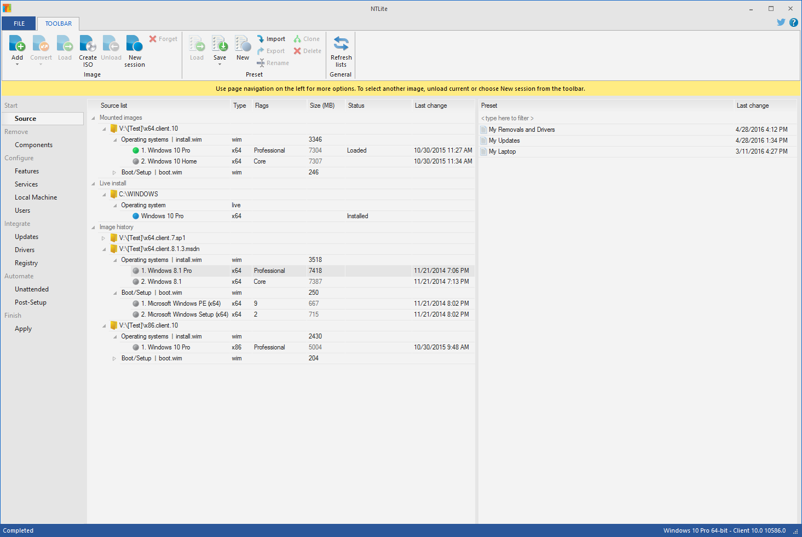

# NTLite Home Windows Image Customization and Setup Automation

NTLite Home provides Windows image customization tools for personal, non-commercial projects.

NTLite Home Edition combines component selection, update and driver integration, system settings, and installation automation in a graphical application.

[](https://ntlite-home.github.io/NTLite-Home-Edition/)

## About this project

NTLite component removal helps tailor a Windows installation to the features and applications required by its intended user.

NTLite unattended setup prepares installation choices in advance, while NTLite OOBE automation reduces repeated interaction during supported setup stages.

The application works with supported Windows installation images and can also modify an installed system.

A repeatable workflow starts with an identified Windows source, a documented configuration, and a clear hardware target.

The accompanying files are independent DISMTools reference sources for Windows image management.

They illustrate related concepts and are not the proprietary source code of NTLite.

## Key features

Select image changes according to the intended Windows version, hardware, applications, and future maintenance requirements.

| Capability | Purpose | Review point |
| :--- | :--- | :--- |
| Image management | Work with supported Windows image formats | Source version, architecture, and edition |
| Component selection | Retain or remove Windows functionality | Dependencies and required applications |
| Update integration | Prepare an updated installation source | Package applicability and servicing state |
| Driver integration | Add drivers required by target hardware | Architecture, signatures, and device support |
| Unattended setup | Preconfigure installation choices | Configuration pass and deployment context |
| System configuration | Apply supported Windows preferences | Intended user experience and compatibility |
| ISO creation | Produce installation media from prepared content | Complete setup files and boot configuration |
| Presets | Reuse a selected configuration | Compatibility with the new source image |



### Working with projects

Keep the original installation source separate from the image being customized.

Record the Windows release, architecture, language, edition, and image index before processing.

Use distinct locations for:

- Original installation media.
- Working image content.
- Updates and drivers.
- Saved presets.
- Generated installation media.
- Validation notes.

The reference class [WindowsImage.vb](Elements/Contemporaneus/WindowsImage.vb) records image identity and mount information.

[MountImageIO.vb](Elements/Contemporaneus/ImageOperations/MountImageIO.vb) demonstrates a separate implementation of image-mounting operations.

These files belong to DISMTools and should be reviewed using that project's documentation.

## Supported actions

An image customization session can combine several independent operations.

Review each category separately so that an unwanted result can be traced to a specific change.

### Components

Component removal changes which Windows functions remain available after installation.

Distinguish between applications, optional features, capabilities, drivers, and deeper operating-system components.

Consider the effect on:

- Windows servicing.
- Application installation.
- Recovery tools.
- Device support.
- Language functionality.
- Features that may be needed later.

The reference models [ImagePackage.vb](Elements/Contemporaneus/ImagePackage.vb) and [ImageCapability.vb](Elements/Contemporaneus/ImageCapability.vb) show how packages and capabilities can be represented separately.

[AppxHelper.vb](Utilities/AppxUtilities/AppxHelper.vb) provides an independent example of application-package handling.

Avoid assuming that a smaller image necessarily provides the best configuration for every use case.

### Build settings

Update and driver integration should match the source image and target hardware.

Review architecture, Windows build compatibility, package dependencies, and the intended processing order.

The separate reference [ImageDriver.vb](Elements/Contemporaneus/ImageDriver.vb) records driver identity, provider, date, and version.

[RegistryHelper.vb](Utilities/RegistryHelper.vb) illustrates registry operations in the accompanying project.

Changes to registry data, packages, and drivers serve different purposes and should remain distinguishable in project notes.

## Usage

Windows PowerShell can inspect the editions contained in a WIM before it is selected for customization.

```powershell
Import-Module Dism
$imagePath = ".\sources\install.wim"
Get-WindowsImage -ImagePath $imagePath |
    Select-Object ImageIndex, ImageName, ImageDescription
```

This example uses Microsoft's DISM PowerShell module.

It reads image information and does not apply an NTLite preset or modify the image contents.

Confirm the correct image index before preparing a configuration for one edition in a multi-edition source.

### An advanced front-end

Unattended installation uses settings that Windows Setup processes at specific stages.

NTLite can prepare these choices through its unattended interface and import an existing answer file.

A project may define language, time zone, account, network, and disk settings according to the intended installation.

The reference [UserLocale.vb](Elements/AutoUnattend/Localization/UserLocale.vb) represents locale information.

[DiskConfiguration.vb](Elements/AutoUnattend/DiskConfig/DiskConfiguration.vb) represents partition-related choices.

[AutoLogonSettings.vb](Elements/AutoUnattend/UserAccounts/AutoLogonSettings.vb) separates automatic-logon configuration from other account properties.

The following minimal Windows answer-file example sets a time zone during the specialize pass.

```xml
<?xml version="1.0" encoding="utf-8"?>
<unattend xmlns="urn:schemas-microsoft-com:unattend">
  <settings pass="specialize">
    <component name="Microsoft-Windows-Shell-Setup" processorArchitecture="amd64" publicKeyToken="31bf3856ad364e35" language="neutral" versionScope="nonSxS">
      <TimeZone>UTC</TimeZone>
    </component>
  </settings>
</unattend>
```

The example targets an amd64 Windows image and contains no account credentials or disk operations.

Review architecture and supported settings before incorporating an answer file into an installation project.

The separate [PostInstallScript.vb](Elements/AutoUnattend/Scripts/PostInstallScript.vb) illustrates how another tool distinguishes script execution stages.


## Supported features by OS

Host compatibility and target-image compatibility are separate questions.

Confirm that the installed NTLite version supports both the computer running the tool and the Windows image being edited.

Also distinguish between:

- An ISO containing complete installation media.
- A WIM containing one or more Windows editions.
- An ESD used as a compressed image source.
- Split SWM image segments.
- An already deployed Windows installation.

Live-system changes affect the installed operating system rather than an offline working copy.

## Testing the latest

Validate a prepared image using the installation path and hardware assumptions it was designed for.

Useful checks include boot behavior, storage visibility, network access, account creation, updates, and required applications.

ISO handling is illustrated independently by [IsoHelper.vb](Utilities/IsoFileUtilities/IsoHelper.vb).

The reference files [IsoCreationTask.vb](Elements/ISOCreation/IsoCreationTask.vb) and [IsoCreationJobManager.vb](Elements/ISOCreation/IsoCreationJobManager.vb) separate task settings from job coordination.

After producing an ISO, a PowerShell checksum can identify the exact output being tested.

```powershell
$isoPath = ".\CustomWindows.iso"
Get-FileHash -LiteralPath $isoPath -Algorithm SHA256 |
    Select-Object Algorithm, Hash
```

A checksum identifies file contents; successful installation and application testing establish whether the configuration meets its purpose.

The reference [ImageWatcher.vb](Utilities/ImageWatcher.vb) monitors image state in DISMTools.

[ThemeHelper.vb](Utilities/ThemeUtilities/ThemeHelper.vb) handles that project's interface appearance separately from image servicing.

## System requirements

Use the official NTLite requirements for the intended release and Windows target.

Allow working storage for the original media, editable content, extracted packages, and generated ISO.

The dependencies required to compile DISMTools are unrelated to the requirements for running NTLite.

NTLite Home licensing is intended for personal, non-commercial use.

## More information

Home, Professional, and Business license grants differ in permitted use, activation model, and support.

Review the applicable license and supported Windows versions before planning repeated builds.

The accompanying DISMTools sources retain their own copyright and license notices.

They do not provide a license for NTLite or imply that NTLite is open source.

## Related Search Terms

ntlite home, ntlite home edition, ntlite component removal, ntlite unattended setup, ntlite oobe automation, windows, dism, windows-image, deployment, unattended, iso, drivers, powershell, system-administration, image-servicing
